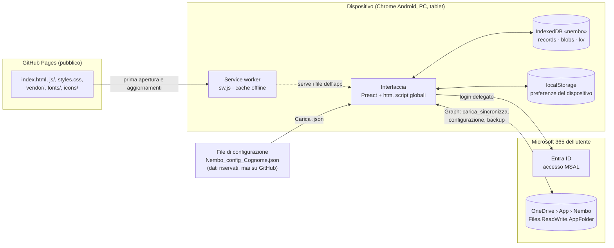
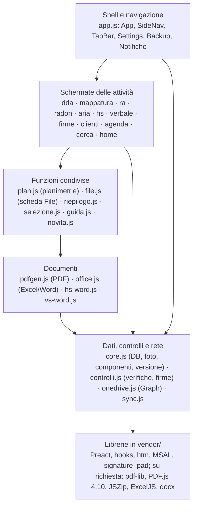
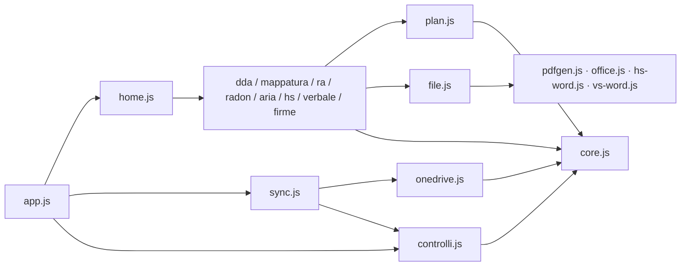
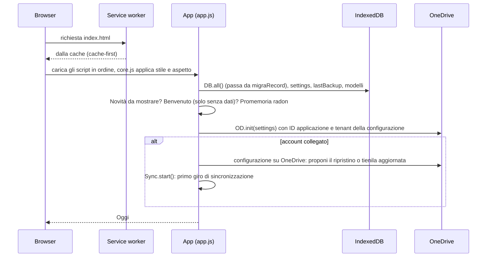

# Architettura

Nembo è una **PWA offline-first** senza server: tutto gira nel browser del dispositivo e i dati restano in IndexedDB.
OneDrive (cartella dell'app, via Microsoft Graph) è facoltativo: serve per consegnare i file, sincronizzare i dispositivi,
tenere la configurazione e i backup. Il codice è pubblico su GitHub Pages; dati, modelli e configurazione non lo sono mai.

## 1. Vista d'insieme

- **Nessun backend**: niente database centrale, niente login obbligatorio. Ogni utente ha la sua configurazione.
- **OneDrive solo nella cartella dell'app**: Nembo non vede il resto del OneDrive e non cancella nulla.
- **Codice pubblico**: nessun indirizzo, ID, nome di persona, cliente o laboratorio nel codice. Tutto passa dal file di configurazione.

## 2. Struttura delle cartelle

| Cartella o file | Contenuto |
|---|---|
| `index.html` | pagina unica: CSP, ordine di caricamento degli script, contenitore dell'app |
| `sw.js` | service worker: `VERSION`, elenco `FILES` messo in cache |
| `manifest.webmanifest` | manifest della PWA (nome, icone, orientamento) |
| `styles.css` | token di Rilievo (inizio file) e stili dei componenti |
| `pdfgen.js` | compilazione dei PDF con pdf-lib |
| `js/` | codice dell'app, script globali (§ 4) |
| `vendor/` | librerie incluse: Preact, hooks, htm, MSAL, signature_pad, pdf-lib, PDF.js 4.10, JSZip, ExcelJS, docx |
| `fonts/` | IBM Plex Sans e Mono (woff2) |
| `icons/`, `splash/` | icone e schermate di avvio |
| `novita/` | immagini delle presentazioni delle Novità |
| `globals.json` | funzioni globali per ESLint |
| `docs/` | questa documentazione |

Fuori dal repository: file di configurazione, modelli aziendali, backup, audit, backlog, sorgenti di guida e presentazione.

## 3. Livelli

## 4. Moduli

Tutti i file sono **script globali** caricati in ordine da `index.html` (nessun `import`, nessuna build).
Ogni file usa le funzioni dei file caricati prima; `globals.json` le elenca per ESLint.

| Ordine | File | Ruolo |
|---|---|---|
| 1 | `vendor/preact.min.umd.js`, `hooks.umd.js`, `htm.umd.js` | Rendering (componenti con `html\`…\``) |
| 2 | `vendor/signature_pad.umd.min.js`, `msal-browser.min.js` | Firma a schermo, accesso Microsoft |
| 3 | `pdfgen.js` | PDF con pdf-lib: scheda radon, schede campioni, fogli firme, schede aria |
| 4 | `js/core.js` | Versione, controllo anti-iframe, tema, `DB` (IndexedDB), foto, `needLib`, componenti base, `TIPO_COL`, `PRINT`, `migraRecord` |
| 5 | `js/capture.js` | Scanner codici a barre, firma a schermo intero, fotocamera interna |
| 6 | `js/plan.js` | Planimetrie: visualizzatore PDF.js, strumenti di disegno, etichette, PDF annotato, import da JSON |
| 7 | `js/office.js` | Excel (ExcelJS, JSZip sul modello) e Word (docx) |
| 8 | `js/dda.js`, `js/mappatura.js`, `js/radon.js`, `js/ra.js` | Attività ambientali, import e indagine precedente |
| 9 | `js/hs-data.js`, `js/hs-word.js`, `js/hs.js`, `js/hs-note.js` | Sopralluogo HSE: dati fissi, motore Word, report a schede e checklist, sopralluogo a note (v53) |
| 10 | `js/verbale.js`, `js/vs-word.js` | Verbale HSE |
| 11 | `js/clienti.js`, `js/novita.js`, `js/guida.js`, `js/riepilogo.js`, `js/cerca.js` | Clienti, Novità, guida, riepilogo email, ricerca |
| 12 | `js/firme.js`, `js/aria.js`, `js/file.js` | Fogli firme, monitoraggio aria, scheda File |
| 13 | `js/controlli.js` | Verifica allegati, pulizia dei dati in ingresso, firma dei backup, PIN della firma, impronta dei fogli |
| 14 | `js/selezione.js` | Selezione di più attività |
| 15 | `js/agenda.js` | Programmazione, piano JSON, .ics |
| 16 | `js/onedrive.js` | `OD` (MSAL + Graph), caricamento per attività, stato di invio |
| 17 | `js/sync.js` | Sincronizzazione tra dispositivi (`_nembo/`) |
| 18 | `js/home.js` | Oggi, Nuova attività, `attAperta`, `daCompletare` |
| 19 | `js/app.js` | `App`: stato globale, navigazione, impostazioni, backup, configurazione su OneDrive, avvio |

## 5. Avvio

- Prima del disegno `core.js` applica stile e aspetto (`nembo_style`, `nembo_mode`) e blocca l'apertura dentro un iframe.
- Il service worker risponde dalla cache; un aggiornamento arriva al secondo avvio (nuova `VERSION` in `sw.js`).

## 6. Navigazione

Stato `route = { v, id?, p?, from? }` in `App`; il tasto Indietro (Android e browser) passa da `Back` (pila di funzioni) e `history`.

| Rotta | Schermata |
|---|---|
| `home` | Oggi |
| `ddaList` → `dda`, `mappaturaList` → `mappatura`, `raList` → `ra`, `radonList` → `radon`, `ariaList` → `aria` | Elenchi e schede Ambiente |
| `hsList` → `hs`, `vsList` → `vs` | HSE |
| `firmeList` → `firme`, `cliList` → `cli`, `agenda`, `cerca`, `backup` | Strumenti |
| `settings` (con `p` = pagina), `notifiche` | Impostazioni e Notifiche |

- **Sotto 1000 px**: tab bar in basso, una schermata alla volta, barra «‹ Padre» nelle schermate figlie.
- **Da 1000 px**: menu laterale, elenco e scheda affiancati (`DETAIL_OF`), barra in alto con Cerca, + e campanella.
- **Notifiche** (v51): in Oggi l'icona di sincronizzazione prende il posto della campanella; gli errori non letti sono un pallino rosso sul profilo (avatar in Oggi, profilo nel menu laterale) e «Notifiche» è la prima voce delle Impostazioni. Nelle altre schermate la campanella resta.

## 7. Stato e salvataggio

- `App` tiene `allRecs` (tutti i record), `records` (solo attività), `settings`, `route`.
- Ogni scheda usa `useAutosave`: ogni modifica aggiorna `updatedAt`, salva dopo 500 ms (e subito se l'app va in background) con `saveRec` → `DB.put` → `Sync.schedule()`.
- Le impostazioni si salvano a ogni modifica (`setSettings`); dalla v51 anche la configurazione su OneDrive, 5 s dopo.
- Store reattivi leggeri con `subscribe`: `Sync`, `OD`, `Sel` (selezione), notifiche, configurazione su OneDrive.

## 8. Librerie e offline

- Tutto in `vendor/` e `fonts/`, **nessuna CDN**; la CSP lo impone.
- Le librerie pesanti si caricano quando servono: `needLib('pdflib' | 'pdfjs' | 'jszip' | 'exceljs' | 'docx')`. PDF.js 4.10 è un modulo ES (`import()`), con il worker in `vendor/pdfjs.worker.min.mjs`.
- `sw.js` mette in cache tutti i file elencati in `FILES`: ogni file nuovo va aggiunto lì.

CSP (in `index.html`):
`default-src 'self'; script-src 'self'; style-src 'self' 'unsafe-inline'; img-src 'self' blob: data:; connect-src 'self' https://login.microsoftonline.com https://graph.microsoft.com https://*.sharepoint.com; frame-src https://login.microsoftonline.com; worker-src 'self'; object-src 'none'; base-uri 'self'; form-action 'none'`

## 9. Integrazioni esterne

| Servizio | Uso | Autenticazione |
|---|---|---|
| Microsoft Entra ID | accesso dell'utente | MSAL Browser, flusso SPA con PKCE, redirect; ID applicazione e tenant dal file di configurazione |
| Microsoft Graph (OneDrive) | invio, sincronizzazione, configurazione, backup nella cartella dell'app (`me/drive/special/approot`) | token delegato `User.Read`, `Files.ReadWrite.AppFolder`, `offline_access`; rinnovo silenzioso, poi redirect |
| GitHub Pages | pubblicazione del codice statico | nessuna (pagina pubblica) |
| Riconoscimento vocale di Chrome | dettatura nei campi | gestito dal browser; l'audio va a Google (segnalato nella Guida) |

Nessun altro servizio: niente CDN, font esterni, analytics o tracciamento.
Flusso dei dati delle operazioni principali (salvataggio, sincronizzazione, invio, backup, configurazione, import, generazione dei file, aggiornamento): [FLUSSI.md](FLUSSI.md).

## 10. Interfaccia: Rilievo

- Token all'inizio di `styles.css`: colori dei quattro temi (Essenziale e Originale, chiaro e scuro), `--fs-*`, `--r-*`, `--sp-*`, `--sh-*`, `--t-*`.
- `TIPO_COL` (colore per tipo di attività) e `PRINT` (colori fissi di stampa) in `core.js`.
- Niente valori scritti a mano nel CSS o negli `style=`: classi `mt-*`, `mb-*`, `lead-gap`, `grow`… e token.
- Dettaglio dei token e dei componenti: [DESIGN_SYSTEM.md](DESIGN_SYSTEM.md).
- Componenti documentati in Rilievo: pulsanti, card, blocco navy, avvisi, righe, campi, badge, indicatore di stato, scheda File, selezione, impostazioni a gruppi, suggerimenti, primi passi, sincronizzazione.

## 11. Test

- Server locale (`python3 -m http.server`) e Playwright con Chromium; `service_workers='block'` per i test di interfaccia.
- Dati di prova creati con le funzioni dell'app (`newDda`, `newRa`, `DB.put`…), solo inventati.
- Prima di un rilascio: nessun errore in console; quattro temi; telefono, tablet verticale e orizzontale, PC; selezione; offline con il service worker attivo; import di prova; Graph simulato per sincronizzazione e backup.

## 12. Rilascio

Ramo della versione → prove → merge in `main` (GitHub Pages). La procedura completa è in [RELEASE_CHECKLIST.md](RELEASE_CHECKLIST.md).
