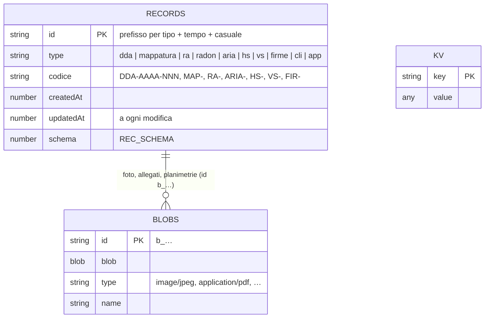
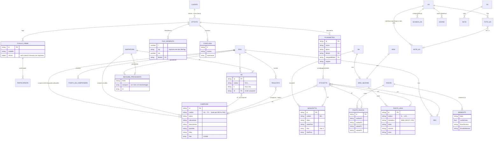

# Modello dei dati

Documento centrale: prima di cambiare entità, campi o storage va letto e aggiornato nella stessa modifica.
Tutti gli esempi usano dati inventati.

## 1. Storage

| Entità | Tecnologia | Chiave | Chi lo vede |
|---|---|---|---|
| Attività (tutti i tipi), clienti, appuntamenti | IndexedDB `nembo`, store `records` | `id` (keyPath) | solo il dispositivo |
| Foto, allegati, planimetrie, file generati | IndexedDB `nembo`, store `blobs` | `id` (`b_…`) | solo il dispositivo |
| Impostazioni, modelli, stati interni | IndexedDB `nembo`, store `kv` | chiave testuale | solo il dispositivo |
| Preferenze del dispositivo | `localStorage` (`nembo_*`) e cache di MSAL | chiave | solo il dispositivo |
| Copie e consegne | OneDrive › App › cartella dell'app (§ 9) | percorso | l'account Microsoft dell'utente |
| Configurazione per utente | file `Nembo_config_<Cognome>.json` | — | chi lo riceve; mai su GitHub |
| Backup | file ZIP firmato (§ 10) | — | chi lo possiede |

Versioni: database IndexedDB **1** (`indexedDB.open('nembo', 1)`), formato dei record **`REC_SCHEMA = 1`** (`js/core.js`).

## 2. Diagramma ER — archivio locale



## 3. Diagramma ER — attività e loro parti

Le parti sono oggetti annidati nel record dell'attività, non tabelle separate: le relazioni sono di contenimento.



## 4. Dizionario delle entità

Tipi: `string`, `number` (ms dall'epoca per gli istanti), `bool`, `data` = stringa `AAAA-MM-GG`, `ora` = `HH:MM`, `blobId` = id in `blobs`, `dataURL` = immagine PNG in base64.

### 4.1 Campi comuni a tutte le attività

| Campo | Tipo | Vincoli | Default | Dato personale | Descrizione |
|---|---|---|---|---|---|
| `id` | string | PK, unico | `uid(prefisso)` | no | Identificativo (`dda_…`, `map_…`, `ra_…`, `rad_…`, `ar_…`, `hs_…`, `vs_…`, `fir_…`) |
| `type` | string | enum § 6 | — | no | Tipo di attività |
| `codice` | string | unico per tipo e anno | `TIPO-AAAA-NNN` | no | Codice leggibile (radon: libero) |
| `createdAt` / `updatedAt` | number | NOT NULL | ora | no | Creazione e ultima modifica (vince la più recente nella sincronizzazione) |
| `schema` | number | — | `REC_SCHEMA` | no | Versione del formato |
| `commessa` | string | — | `''` | no | Numero di commessa |
| `cliente` | string | testo libero, collegato a `cli.nome` | `''` | sì, se persona fisica | Committente |
| `citta`, `indirizzo`, `sito` | string | — | `''` | no | Luogo e codice sito |
| `data`, `ora`, `durata` | data, ora, number (min) | — | oggi, `''`, per tipo | no | Programmazione |
| `stato` | string | enum § 6 | `''` | no | Stato di programmazione |
| `tecnico` | string | — | nome e cognome dalle impostazioni | sì | Tecnico che compila |
| `planimetrie` | array | — | `[]` | no | § 4.6 |
| `appunti`, `fotoAppunti` | string, blobId[] | — | `''`, `[]` | foto: possibile | Appunti liberi e foto |
| `tagAppunti` (DDA anche `tagAppunti2`) | string[] | — | — | no | Tag degli appunti; ogni campo che inizia con `tag` è raccolto da `collectTags` |
| `documenti` | array | file ammessi da `controlli.js` | `[]` | possibile | Allegati (DDA, HSE) |
| `fogli` | array | — | `[]` | sì | Fogli firme § 4.7 |
| `firme` | bool | — | — | no | Foglio firme preparato alla creazione |
| `files` | object | chiave → `FILE_GENERATO[]` | `{}` | no | Documenti generati § 4.8 |
| `imp` | object | — | — | no | Campi importati e protetti dal lucchetto |
| `conclusa` | object \| null | — | assente | no | `{ il: data, motivo, mancanze: string[] }` (v50) |
| `drone` | bool | solo dda, mappatura, ra | — | no | Sopralluogo con drone |
| `copiaDi`, `copiaNota` | string | — | — | no | Copia nata da un conflitto di sincronizzazione |

### 4.2 DDA (`type: 'dda'`)

| Campo | Tipo | Vincoli | Default | Dato personale | Descrizione |
|---|---|---|---|---|---|
| `fase` | number | 1 \| 2 | 1 | no | Fase della due diligence |
| `usoAttuale`, `usoStorico` | string | — | `''` | no | Uso del sito |
| `check` | object | voce → `presente` \| `assente` \| `nv` | `{}` | no | Checklist del sopralluogo (9 voci) |
| `checkNote` | object | voce → testo | `{}` | no | Note della checklist |
| `recs` | array | `{ id, nome, descrizione, foto[], lat, lon }` | `[]` | no | Aree di potenziale contaminazione |
| `interviste`, `appunti2`, `fotoAppunti2` | string, string, blobId[] | — | vuoti | possibile | Interviste e appunti di Fase 2 |
| `campioni` | object | `{ terreni, acque, mca, fav, altro }` di `CAMPIONE[]` | tutte vuote | no | § 4.3 |
| `nc` | array | `NC[]` | `[]` | no | Non campionati |
| `congelati` | object | matrice → bool | `{}` | no | Codici bloccati dopo la scheda campioni |
| `schede` | object | — | `{}` | no | Stato delle schede campioni |
| `checklist` | array | `{ id, matrice, descrizione, ubicazione, fatto, daRec? }` | `[]` | no | Punti da campionare |
| `risultati` | array | `{ id, campione (codice), parametro, valore }` | `[]` | no | Risultati vs CSC |
| `colonna` | string | `A` \| `B` | `B` | no | Colonna delle CSC |
| `precedente` | object | `{ fonte, campioni[], nc[] }` | assente | no | Indagine precedente (v50), solo riferimento |
| `numerazione` | string | `prosegui` \| `nuova` | `prosegui` | no | Numerazione dei nuovi campioni (v50) |

### 4.3 Campione e NC (DDA e Mappatura)

| Campo | Tipo | Vincoli | Default | Dato personale | Descrizione |
|---|---|---|---|---|---|
| `id` | string | PK | `uid('c')` | no | — |
| `codice` | string | MCA `A<n>`, FAV `F<n>` automatici; altre matrici libero | prossimo | no | Rinumerato finché la matrice non è in `congelati` |
| `piano`, `ubicazione`, `descrizione` | string | — | piano dell'ultimo | no | Nella scheda: «Piano - Ubicazione - Descrizione» |
| `tipo`, `quantita` | string | — | `''` | no | Tipologia e quantità con unità |
| `data` | data | — | oggi | no | Data di prelievo |
| `foto` | blobId[] | — | `[]` | no | Foto del campione |
| NC `codice` | string | `NC<n>` unico per MCA e FAV | — | no | — |
| NC `k` | string | `mca` \| `fav` | — | no | Matrice |
| NC `rif` | string | FK → `CAMPIONE.id` (anche dell'indagine precedente) | `''` | no | Campione di riferimento |

### 4.4 Mappatura (`type: 'mappatura'`)

Come la DDA per `campioni` (solo `mca`, `fav`), `nc`, `congelati`, `schede`, `precedente`, `numerazione`; in più `tab` (matrice aperta). `recs` e `documenti` sono sempre vuoti.

### 4.5 Sopralluogo RA, monitoraggio aria, radon

| Entità.campo | Tipo | Vincoli | Default | Dato personale | Descrizione |
|---|---|---|---|---|---|
| RA `fonte` | string | — | `''` | no | Origine dei manufatti (PMC, mappatura, anno precedente) |
| RA `incaricoDal`, `incaricoAl` | data | `al` = `dal` + 1 anno − 1 giorno | `''` | no | Incarico del Responsabile Amianto |
| RA `manufatti` | array | `MANUFATTO[]` | `[]` | no | — |
| RA `ripresoDa` | string | FK → RA dell'anno prima | — | no | Ripresa dall'anno precedente |
| MANUFATTO `codice`, `ubicazione`, `descrizione`, `tipologia`, `quantita` | string | — | `''` | no | — |
| MANUFATTO `stato` / `statoPrec` | string | enum § 6 | `''` | no | Stato di conservazione attuale e precedente |
| MANUFATTO `note` / `notePrec` | string | — | `''` | no | — |
| MANUFATTO `foto` / `fotoPrec` | blobId[] | `foto` max 3 | `[]` | no | — |
| `aria` | object | `{ attivo, punti[], rapporti[] }` | `attivo: true` nel tipo `aria` | no | Monitoraggio (attività a sé o sezione dell'RA) |
| PUNTO_ARIA | object | `{ id, codice, piano, postazione, foto[], stato, data, oraInizio, oraFine, campionatore, membrana, metodica, flusso, volume, rdp, conc, note }` | metodica `SEM` | no | Codice `S<n>` (SEM, FAV) o `M<n>` (MOCF) |
| radon `insegna`, `provincia`, `telefono`, `altro`, `note` | string | — | `''` | `telefono`: sì | Dati del punto vendita |
| radon `momenti` | array | esattamente 3 | vuoti | sì | `{ data, tecnicoNome, tecnicoCognome, firmaTecnico, referenteNome, referenteCognome, firmaReferente, confermato }`; firme come dataURL |
| radon `punti` | array | `{ id, piano, ubicazione, accesso, apertura, clima, codiceF1, codiceF2, foto[], valoreF1, valoreF2 }` | `[]` | no | Dosimetri |
| radon `rapporti` | array | — | `[]` | no | Rapporti di prova allegati |
| radon `promemoria`, `avvisoFatto` | — | — | — | no | Promemoria del ritiro e avviso già mostrato |

### 4.6 Planimetria ed etichette

| Campo | Tipo | Vincoli | Default | Dato personale | Descrizione |
|---|---|---|---|---|---|
| `id`, `nome`, `piano` | string | — | piano proposto da `pianoDaNome` | no | — |
| `blobId` | blobId | NOT NULL | — | no | PDF originale, mai modificato |
| `mergedBlobId` | blobId | — | — | no | PDF annotato |
| `annot` | object | pagina → `{ strokes[], labels[] }` | `{}` | no | Disegni; `labels[].ref` = id di campione, NC, REC, manufatto o punto |
| `origine`, `fonte`, `didascalia` | string | `origine`: `''` \| `storica` | — | no | Planimetria importata da JSON (v50) |

### 4.7 Foglio firme

| Campo | Tipo | Vincoli | Default | Dato personale | Descrizione |
|---|---|---|---|---|---|
| `id`, `modello`, `titolo`, `sottotitolo`, `testo`, `note` | string | `modello` = id in `settings.firmeModelli` | dal modello | no | Testi compilati con i dati dell'attività |
| `data`, `luogo`, `relatore`, `responsabile` | string | — | oggi, città, prelevatoDa | sì (nomi) | — |
| `documenti` | array | `{ t, ok }` | dal modello | no | Documenti consegnati |
| `inclMan`, `manSel` | bool, string[] \| null | — | — | no | Elenco di manufatti, campioni o punti |
| `partecipanti` | array | `{ id, nome, societa, ruolo, firma, ts }` | `[]` | **sì** (nome, firma) | Chi firma |
| `firmaRelatore` | dataURL | — | `''` | **sì** | — |
| `chiuso` | object \| null | — | `null` | no | Chiusura, con impronta SHA-256 nel PDF (v49) |
| `auto`, `tpl` | bool, object | — | — | no | Foglio preparato alla creazione |

### 4.8 File generato

`files[chiave] = [{ t, sig, rev, blobId, name }]`: `t` istante, `sig` impronta dei dati da cui dipende (`fileSig`), `rev` revisione (`_revN`), una voce per revisione.

### 4.9 HSE e Verbale

| Entità.campo | Tipo | Dato personale | Descrizione |
|---|---|---|---|
| hs `formato` | `esteso` \| `sintetico` | no | Formato del report |
| hs `meta` | object | sì (redatto, verificato, approvato, presenti, firma) | Dati del report |
| hs `foto` | `[{ id, cap, inc, g: 'prev' \| 'new', ref, ts }]` | possibile | Rilievo fotografico; `ref` = id della voce (Sintetico) o chiave della sezione `sch.<k>` / `sch.<k>.<sottosezione>` (Esteso, v52); vuoto = foto senza collegamento |
| hs `base` | object | no | Testi dell'anno precedente |
| hs Esteso `visite`, `an`, `catFab`, `catTer`, `schede` | — | sì (`visite`: nomi) | Schede per sistema: `{ sit, subs, mig, natura, costo, idr, prio, cProp, cCond, termine }` |
| hs Sintetico `anS`, `risp`, `note`, `descr`, `azioni`, `cgFoto` | — | `anS`: sì (nomi) | Checklist e azioni |
| hs `formatoLibero` | boolean | no | `true` (v56) = primo sopralluogo a formato libero: le osservazioni usano sempre i capitoli dell'Esteso (`hsCapi`); `formato` è solo il modello scelto per il Word (ultimo usato, `nembo_hs_formato` in localStorage), cambiabile in Anagrafica e nel Riepilogo. Con il Sintetico `hsInSintetico` porta ogni capitolo dell'Esteso nel capitolo 3–7 corrispondente (`HS_E2S`) e la sottosezione nel testo; assente = formato fissato alla creazione (sopralluoghi prima della v56) |
| hs `aNote` | boolean | no | `true` = sopralluogo a note (primo sopralluogo, v53, `js/hs-note.js`); assente = report a schede (Esteso) o a checklist (Sintetico) |
| hs `noteSop` | `[{ id, titolo, testo, mig, tag[] }]` | possibile | Note del sopralluogo a note. Capitolo = primo tag uguale a un capitolo del formato (Esteso: le 13 schede; Sintetico: capitoli 3–7); sottosezione = primo tag uguale a una sottosezione (Esteso) o a una voce (Sintetico, «3.2 Recinzione deteriorata», riconosciuta dal numero). Foto in `foto` con `ref = n.<id>`; nel Word e nei file (OneDrive, ZIP, riepilogo) l'ordine è quello dei capitoli (`hsFotoOrd` → `hsNoteAOld`); le foto delle note senza capitolo restano fuori dal Word. In ingresso `pulisciRecord` riporta ogni nota alla forma: `id`, `titolo`, `testo`, `mig` testi, `tag` elenco di testi |
| hs `daScegliere` | `primo` \| `periodico` | no | Sopralluogo programmato non ancora avviato (v55): `formato` è vuoto; all'apertura `HsDaAvviare` fa scegliere Esteso o Sintetico (primo) oppure il report di partenza (periodico), poi il campo sparisce |
| hs `np` | `{ <capitolo>: true }` | no | Capitoli «Non pertinente» del sopralluogo a note (chiavi Esteso `agibilita`…, Sintetico `c3`…`c7`). Vale solo per i capitoli senza note: le note hanno sempre la precedenza (Check-list e Word) |
| vs `meta` | object | sì | `{ titolo, fondo, dataReport, redatto, verificato, protocollo, procura, revisione, presenti, descrArea }` |
| vs `note` | `[{ id, titolo, testo, mig, foto[], tag[] }]` | possibile | Note del verbale |

### 4.10 Cliente (`type: 'cli'`) e appuntamento (`type: 'app'`)

| Campo | Tipo | Vincoli | Default | Dato personale | Descrizione |
|---|---|---|---|---|---|
| cli `nome` | string | unico senza accenti e maiuscole | `''` | sì, se persona fisica | Ragione sociale |
| cli `referente`, `telefono`, `email`, `sede`, `note` | string | — | `''` | **sì** | Contatti |
| cli `firme`, `firmeModello` | bool, string | — | `false`, `''` | no | Foglio firme pronto |
| cli `mail`, `mailA`, `mailCc` | bool, string | — | `false`, `''` | sì | Invio dei documenti per email |
| app `titolo`, `luogo`, `note`, `data`, `ora`, `durata`, `stato` | — | — | durata 60 | possibile | Appuntamento in Programmazione |

### 4.11 Impostazioni (`kv.settings`, `DEFAULT_SETTINGS`)

| Campo | Dato personale | Descrizione |
|---|---|---|
| `tecnicoNome`, `tecnicoCognome`, `prelevatoDa`, `verificatoDa` | sì | Tecnico |
| `firmaTecnico` | **sì** | dataURL; mai nel file di configurazione, su OneDrive solo cifrata |
| `emailReferti`, `supportEmail` | sì | Indirizzi |
| `labNome`, `labR1`, `labR2`, `offerta`, `offertaRev`, `mcaCodice`, `mcaDesc`, `favCodice`, `favDesc` | no | Scheda campioni |
| `livelloRif` | no | Radon, predefinito 300 Bq/m³ |
| `buDefault` | no | `ambiente` \| `hs` \| `sicurezza` |
| `ariaCampionatori`, `ariaTaratura`, `ariaProfili` | sì (`ariaTaratura`) | Monitoraggio aria |
| `firmeEnte`, `firmeModelli` | no | Fogli firme |
| `odSync`, `cfgOd` | no | Sincronizzazione e configurazione su OneDrive (predefiniti `true`) |
| `durate` | no | Durate per tipo |
| `hsComm…`, `hsVerificato`, `hsApprovato`, `hsFirma`, `hsDeveloper`, `hsPropertyManager`, `hsProcuratore`, `hsTecnici` | sì | Valori proposti nei report HSE |
| `msClientId`, `msTenantId` | no (identificativi, non segreti) | Registrazione dell'app in Entra ID; mai nel codice |

## 5. Relazioni

| Relazione | Cardinalità | Realizzazione | Alla cancellazione |
|---|---|---|---|
| Attività → parti (campioni, manufatti, punti, fogli…) | 1:N | array annidati | eliminate con l'attività |
| Record → blob | 1:N | id `b_…` ovunque nel record (`blobIds`) | blob eliminati con il record; su OneDrive restano |
| NC → campione | N:1 | `rif` = `CAMPIONE.id` | eliminando il campione l'NC resta senza riferimento |
| Etichetta → elemento | N:1 | `labels[].ref` | etichetta orfana non mostrata nel vassoio |
| Risultato → campione | N:1 | `campione` = codice | resta con il codice scritto |
| Attività → cliente | N:1 | testo `cliente` confrontato con `cli.nome` (`clienteDi`) | nessun vincolo: l'attività tiene il nome |
| RA → RA anno prima | 1:1 | `ripresoDa`, stesso immobile (`stessoImmobile`) | nessun vincolo |
| Attività su più dispositivi | — | `_nembo/records/<id>.json` | eliminazione = lapide `{ deleted, id, deletedAt }`, propagata agli altri dispositivi |

Non ci sono relazioni N:M.

## 6. Enumerazioni

| Campo | Valori |
|---|---|
| `type` | `dda`, `mappatura`, `ra`, `radon`, `aria`, `hs`, `vs`, `firme`, `cli`, `app` |
| `stato` (programmazione) | `confermato`, `in_attesa`, `da_programmare`, `annullato`; vuoto = calcolato dall'ora (`progDi`) |
| matrici (`MATS`) | `terreni`, `acque`, `mca` (codici A), `fav` (codici F), `altro` |
| `check[voce]` | `presente`, `assente`, `nv` (non verificabile) |
| MANUFATTO `stato` (`RA_STATI`) | `integro` (non suscettibile), `suscettibile`, `danneggiato`, `nonispez` (non ispezionabile), `rimosso`; vuoto = da verificare («Non visionato» se l'RA è conclusa) |
| PUNTO_ARIA `metodica` | `SEM` (limite 2 ff/l), `MOCF` (20 ff/l), `FAV` (nessun limite) |
| PUNTO_ARIA `stato` | `''`, `fatto`, `non` |
| stato radon (calcolato, `radonStato`) | `da_iniziare`, `fase1`, `fase2`, `esiti`, `terminata` |
| esito campione precedente | `positivo`, `negativo`, `''` |
| HSE `prio` | 1 non conforme, 2 da monitorare, 3 conforme |
| notifica `level` | `ok`, `warn`, `err`, `info`, `new` |

Stati calcolati, non salvati: `radonStato`, `attAperta`, `photoItems`, `odStatus`, `fileSig`, `syncColore`.

## 7. Indici e vincoli di unicità

- Store `records` e `blobs`: chiave primaria `id`; nessun indice secondario (le ricerche sono in memoria su `DB.all()`).
- `codice` unico per tipo e anno, calcolato alla creazione (massimo esistente + 1).
- Codici MCA, FAV e NC unici dentro l'attività; con `numerazione: 'prosegui'` partono dopo il numero più alto dell'indagine precedente o delle attività dello stesso immobile (`precBase`).
- Un record nuovo lasciato vuoto (`_new` + `…IsEmpty`) non viene salvato.

## 8. Chiavi `kv` e `localStorage`

| Chiave | Contenuto |
|---|---|
| `settings` | impostazioni (§ 4.11) |
| `tpl_radon`, `tpl_scheda`, `tpl_scheda_xlsx`, `tpl_hs_esteso`, `tpl_hs_sintetico`, `tpl_vs` | modelli aziendali (ArrayBuffer) |
| `lastBackup`, `notifiche` (ultime 200), `novita_vista`, `benvenuto_visto`, `hs_frasi` | stato dell'app |
| `od_synced`, `od_sent`, `od_folders`, `od_files`, `od_log` | caricamento su OneDrive |
| `sync_state`, `sync_blobs`, `sync_del`, `sync_last` | sincronizzazione |
| `chiave_dispositivo`, `chiave_pubblicata`, `chiave_utente`, `chiavi_note` | firma dei backup (chiave privata non esportabile) |
| `archiviate` | attività tolte dal dispositivo e ancora su OneDrive (v49) |
| `cfg_od` | configurazione su OneDrive: `{ ok, last, mese, err, nonOra, firmaRemota }` (v51) |
| `cfg_pin` | sale e chiave AES non esportabile ricavata dal PIN (v51) |

`localStorage`: `nembo_style`, `nembo_mode`, `nembo_nav`, `nembo_onb`, `nembo_tips`, `nembo_tab_<tipo>`, `nembo_ag_v`, `nembo_cam_serie`, `nembo_solo_penna`, cache di MSAL.

## 9. OneDrive

```text
OneDrive › App › <nome dell'app in Entra ID>/
├── <codice attività o luogo>/        ← «Invia a OneDrive»: cartelle leggibili
│   ├── foto/  documenti/  firme/  aria/  planimetrie
│   ├── Scheda_campioni_MCA.pdf  Riepilogo_campioni.docx …
│   └── dati.json                     ← l'intero record
└── _nembo/                           ← uso interno
    ├── records/<id>.json             ← { app, kind: 'sync', version, record, blobs, savedAt } o lapide
    ├── blobs/<blobId>                ← foto e file, una volta sola
    ├── chiavi/<impronta>.json        ← chiave pubblica di ogni dispositivo
    ├── config/configurazione.json    ← configurazione (v51)
    ├── config/configurazione_AAAA-MM.json ← primo salvataggio di ogni mese
    └── backup/Nembo_backup_AAAA-MM-GG_HHMM.zip ← backup (v51), mai cancellati; l'app mostra gli ultimi 3
```

## 10. Esempi

**Attività DDA Fase 2** (ridotta ai campi principali)
```json
{
  "id": "dda_mh3k2x9ab12cd", "type": "dda", "codice": "DDA-2026-004", "schema": 1,
  "createdAt": 1793000000000, "updatedAt": 1793003600000,
  "commessa": "000/26", "cliente": "Immobiliare Esempio S.r.l.", "citta": "Città Demo", "indirizzo": "Via degli Esempi 12", "sito": "",
  "data": "2026-11-10", "ora": "09:00", "durata": 180, "stato": "confermato", "tecnico": "Luca Bianchi", "fase": 2,
  "campioni": {
    "terreni": [], "acque": [], "fav": [], "altro": [],
    "mca": [{ "id": "c_mh3k3a1x2y3z", "codice": "A3", "piano": "Copertura", "ubicazione": "Falda nord", "descrizione": "Lastra ondulata", "tipo": "", "quantita": "850 m²", "data": "2026-11-10", "foto": ["b_mh3k3b9q8w7e"] }]
  },
  "nc": [{ "id": "n_mh3k3c4r5t6y", "codice": "NC2", "k": "mca", "piano": "Copertura", "ubicazione": "Falda sud", "descrizione": "Come A3", "quantita": "", "rif": "c_mh3k3a1x2y3z", "foto": [] }],
  "congelati": {}, "numerazione": "prosegui",
  "precedente": { "fonte": "DDA Fase 2 2024", "campioni": [{ "id": "c_prec1", "codice": "A1", "k": "mca", "esito": "positivo", "esitoDettaglio": "crisotilo 5-10%" }], "nc": [] },
  "planimetrie": [], "fogli": [], "files": {}
}
```

**Sopralluogo RA, un manufatto**
```json
{ "id": "m_mh3k4d", "codice": "M1", "ubicazione": "Copertura capannone", "descrizione": "Lastre ondulate", "tipologia": "Compatto", "quantita": "1200 m²",
  "statoPrec": "integro", "notePrec": "", "stato": "suscettibile", "note": "Lastre esposte a urti", "foto": [], "fotoPrec": [] }
```

**Campagna radon, un punto**
```json
{ "id": "p_mh3k5e", "piano": "Piano terra", "ubicazione": "Vendita", "accesso": true, "apertura": false, "clima": true,
  "codiceF1": "DS48211", "codiceF2": "DS48390", "foto": [], "valoreF1": "180", "valoreF2": "210" }
```

**Cliente**
```json
{ "id": "cli_mh3k6f", "type": "cli", "nome": "Fondo Demo SGR", "referente": "Referente Esempio", "telefono": "000 0000000", "email": "referente@esempio.it",
  "sede": "Viale delle Prove 8, Città Demo", "note": "", "firme": true, "firmeModello": "presenze", "mail": true, "mailA": "referente@esempio.it", "mailCc": "",
  "createdAt": 1793000000000, "updatedAt": 1793000000000 }
```

**File di configurazione** (`Nembo_config_<Cognome>.json`)
```json
{ "app": "nembo", "type": "config", "version": 1, "createdAt": "2026-11-10T09:00:00.000Z",
  "settings": { "tecnicoNome": "Luca", "tecnicoCognome": "Bianchi", "livelloRif": 300, "msClientId": "00000000-0000-0000-0000-000000000000" },
  "templates": { "tpl_radon": "<base64>", "tpl_scheda": "<base64>" },
  "utente": { "per": "…", "k": "…" } }
```
`utente` (codice utente) è solo nel file esportato. La copia su OneDrive non ha `utente` e ha `firma` cifrata: `{ "alg": "PBKDF2-SHA256/AES-GCM", "iter": 310000, "salt": "…", "iv": "…", "ct": "…" }`.

**Programmazione** (`AAAA_MM_GG_Nembo_Programmazione.json`; più giorni = data del primo)
```json
{ "type": "nembo-programmazione",
  "attivita": [
    { "tipo": "ra", "data": "2026-11-12", "ora": "09:00", "durata": 120, "stato": "confermato", "commessa": "000/26",
      "cliente": "Fondo Demo SGR", "citta": "Città Demo", "indirizzo": "Viale delle Prove 8", "sito": "", "firme": true, "drone": false, "note": "" },
    { "tipo": "dda2", "data": "2026-11-12", "ora": "14:00", "durata": 180, "commessa": "001/26", "cliente": "Immobiliare Esempio S.r.l.",
      "citta": "Città Demo", "indirizzo": "Via degli Esempi 12", "numerazione": "prosegui" } ] }
```
Tipi: `ra`, `dda1`, `dda2`, `mappatura`, `radon`, `aria`, `hsPrimo` e `hsPeriodico` (sopralluogo HSE da avviare), `hsE` e `hsS` (piani preparati prima della v55), `vs`, `firme`. Gli altri formati di import (`ra-mappatura`, `dda-fase1`, `dda-fase2`) sono in `RA_TEMPLATE` (ra.js), `DDA1_TEMPLATE` e `DDA2_TEMPLATE` (dda.js); prompt in `Nembo_Prompt.txt`, fuori dal repository. Campo comune `planimetrie: [{ nome, piano, didascalia, origine: "storica", fonte, formato: pdf|jpeg|png, dati }]`.

**ZIP di backup**
```text
Nembo_backup_AAAA-MM-GG_HHMM.zip
├── <attività>/foto/…  documenti/…  firme/…  aria/…  *.pdf  *.docx
├── _modelli/       ← modelli aziendali (backup completo)
├── manifest.json   ← { app, version, impronte: 'sha256', exportedAt, records, files: { blobId: { path, type, name, sha256 } }, settings?, templates? }
└── firma.json      ← firma ECDSA P-256 del dispositivo e firma del codice utente su manifest.json
```
Il backup salvato sul dispositivo contiene la firma del tecnico (decisione DAT-02); quello su OneDrive no.

## 11. Versionamento e migrazioni

| Elemento | Versione | Gestione |
|---|---|---|
| Database IndexedDB | 1 | `onupgradeneeded` crea `records`, `blobs`, `kv`. Un nuovo store richiede `indexedDB.open('nembo', 2)` con il passaggio in `onupgradeneeded` |
| Formato dei record | `REC_SCHEMA = 1` (dalla v49) | `migraRecord(r)` porta ogni record letto (`DB.all`) o salvato (`DB.put`) al formato attuale; schema 1 = forma della v49, i record precedenti ricevono solo il numero |
| File di sincronizzazione | `version: 1` | i campi sconosciuti passano da `pulisciRecord` |
| File di configurazione | `version: 1` | `pulisciImpostazioni` tiene solo i campi noti |
| ZIP di backup | `manifest.version: 1` | `impronte: 'sha256'` dalla v48; i backup senza firma chiedono conferma |

Regola: se cambia la forma di un record, aumentare `REC_SCHEMA`, aggiungere il passaggio in `migraRecord`, aggiornare questo documento e `CHANGELOG.md`.
