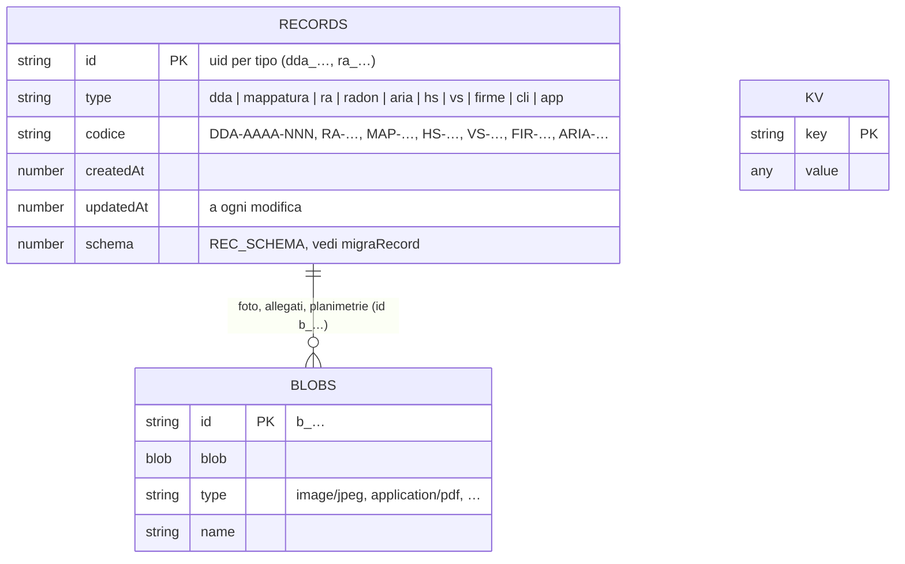
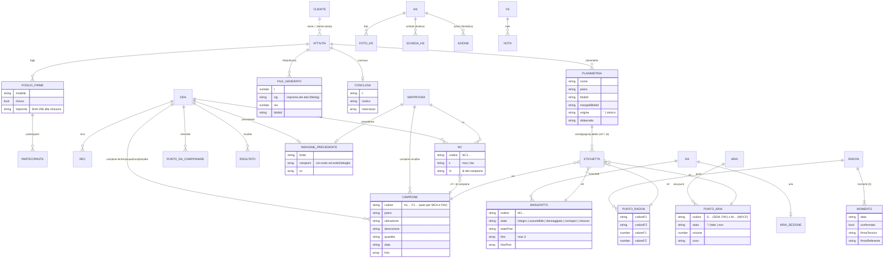

# Dati di Nembo

## 1. Dove sono i dati

| Luogo | Cosa | Chi lo vede |
|---|---|---|
| IndexedDB `nembo` (store `records`, `blobs`, `kv`) | attività, foto e file, impostazioni, modelli, stati | solo il dispositivo |
| `localStorage` | preferenze del dispositivo (stile, menu, ultima scheda…) e cache di MSAL | solo il dispositivo |
| OneDrive › App › Nembo | cartelle leggibili per attività, copia di sincronizzazione `_nembo/`, configurazione, backup | l'utente (il suo account Microsoft) |
| File di configurazione `Nembo_config_<Cognome>.json` | impostazioni, modelli, codice utente | chi lo riceve; mai su GitHub |
| ZIP di backup | tutte le attività, impostazioni e modelli, firmato | chi lo ha |

## 2. Archivio locale (IndexedDB)



- `blobIds(obj)` trova ricorsivamente tutti gli id `b_…` di un record: serve per eliminare, zippare e sincronizzare.
- `DB.all()` e `DB.put()` passano da `migraRecord`: un record vecchio viene portato al formato attuale.
- Un record nuovo lasciato vuoto (`_new` e `…IsEmpty`) viene scartato all'uscita.

## 3. Attività e loro parti

Campi comuni a tutte le attività: `id, type, codice, createdAt, updatedAt, commessa, cliente, citta, indirizzo, sito, data, ora, durata, stato, tecnico, planimetrie[], fotoAppunti[], appunti, documenti[], fogli[], files{}, imp{}, conclusa?, drone?`.



Dettagli per tipo:

| Tipo | Codice | Campi propri |
|---|---|---|
| `dda` | `DDA-AAAA-NNN` | `fase` (1, 2), `usoAttuale`, `usoStorico`, `check{}`, `checkNote{}`, `recs[]`, `interviste`, `appunti2`, `fotoAppunti2[]`, `campioni{terreni, acque, mca, fav, altro}`, `nc[]`, `congelati{}`, `schede{}`, `checklist[]`, `risultati[]`, `colonna` (A, B), `precedente`, `numerazione` |
| `mappatura` | `MAP-AAAA-NNN` | `campioni{mca, fav}`, `nc[]`, `congelati{}`, `precedente`, `numerazione`, `tab` |
| `ra` | `RA-AAAA-NNN` | `fonte`, `incaricoDal`, `incaricoAl`, `manufatti[]`, `ripresoDa`, `aria?` |
| `radon` | codice libero | `insegna`, `provincia`, `telefono`, `momenti[3]`, `punti[]`, `rapporti[]`, `promemoria`, `avvisoFatto` |
| `aria` | `ARIA-AAAA-NNN` | `aria{attivo, punti[], rapporti[]}` |
| `hs` | `HS-AAAA-NNN` | `formato` (esteso, sintetico), `meta{}`, `img{}`, `foto[{id, cap, inc, g: prev|new, ref}]`, `base{}`, Esteso: `visite[]`, `an{}`, `catFab[]`, `catTer[]`, `schede{}`; Sintetico: `anS[]`, `risp{}`, `note{}`, `azioni[]`, `cgFoto[]` |
| `vs` | `VS-AAAA-NNN` | `meta{}`, `img{}`, `visite[]`, `note[{titolo, testo, mig, foto[], tag[]}]` |
| `firme` | `FIR-AAAA-NNN` | foglio firme a sé: `fogli[]` |
| `cli` | — | `nome`, `referente`, `telefono`, `email`, `sede`, `note`, `firme`, `firmeModello`, `mail`, `mailA`, `mailCc` |
| `app` | — | appuntamento: `titolo`, `luogo`, `note`, `data`, `ora`, `durata`, `stato` |

Stati calcolati (non salvati): stato radon (`radonStato`), attività aperta (`attAperta`), elementi senza foto (`photoItems`), stato di invio (`odStatus`), stato dei file (`fileSig`).

## 4. Chiavi `kv`

| Chiave | Contenuto |
|---|---|
| `settings` | impostazioni (`DEFAULT_SETTINGS` + configurazione) |
| `tpl_radon`, `tpl_scheda`, `tpl_scheda_xlsx`, `tpl_hs_esteso`, `tpl_hs_sintetico`, `tpl_vs` | modelli aziendali (ArrayBuffer) |
| `lastBackup`, `notifiche`, `novita_vista`, `benvenuto_visto`, `hs_frasi` | stato dell'app |
| `od_synced`, `od_sent`, `od_folders`, `od_files`, `od_log` | caricamento su OneDrive (stato per attività, file già inviati, cartelle, URL, registro) |
| `sync_state`, `sync_blobs`, `sync_del`, `sync_last` | sincronizzazione |
| `chiave_dispositivo`, `chiave_pubblicata`, `chiave_utente`, `chiavi_note` | firma dei backup (chiave privata non esportabile) |
| `archiviate` | attività tolte dal dispositivo e ancora su OneDrive (v49) |
| `cfg_od` | configurazione su OneDrive: collegato, ultimo salvataggio, mese, errore, firma remota (v51) |
| `cfg_pin` | sale e chiave AES non esportabile ricavata dal PIN della firma (v51) |

`localStorage`: `nembo_style`, `nembo_mode`, `nembo_nav`, `nembo_onb`, `nembo_tips`, `nembo_tab_<tipo>`, `nembo_ag_v`, `nembo_cam_serie`, `nembo_solo_penna`, cache di MSAL.

## 5. OneDrive

```text
OneDrive › App › <nome dell'app in Entra ID>/
├── <codice attività o luogo>/        ← «Invia a OneDrive»: cartelle leggibili
│   ├── foto/  documenti/  firme/  aria/  planimetrie
│   ├── Scheda_campioni_MCA.pdf  Riepilogo_campioni.docx …
│   └── dati.json                     ← l'intero record
└── _nembo/                           ← uso interno
    ├── records/<id>.json             ← sincronizzazione: { app, kind: 'sync', version, record, blobs, savedAt } o lapide { deleted, id, deletedAt }
    ├── blobs/<blobId>                ← foto e file, una volta sola
    ├── chiavi/<impronta>.json        ← chiave pubblica di ogni dispositivo
    ├── config/configurazione.json    ← configurazione (v51), sostituita a ogni modifica
    ├── config/configurazione_AAAA-MM.json ← primo salvataggio di ogni mese
    └── backup/Nembo_backup_AAAA-MM-GG_HHMM.zip ← backup completi (v51); Nembo ne mostra gli ultimi 3 e non cancella nulla
```

## 6. Formati JSON

**File di configurazione**
```json
{ "app": "nembo", "type": "config", "version": 1, "createdAt": "…",
  "settings": { "…": "senza firmaTecnico" },
  "templates": { "tpl_radon": "<base64>", "tpl_scheda": "<base64>" },
  "utente": { "per": "…", "k": "…" },
  "firma": { "alg": "PBKDF2-SHA256/AES-GCM", "iter": 310000, "salt": "…", "iv": "…", "ct": "…" } }
```
`utente` (codice utente) è solo nel file esportato; `firma` (cifrata con il PIN) solo nella copia su OneDrive.

**Import** (prompt in `Nembo_Prompt.txt`): `nembo-programmazione` (piano), `ra-mappatura` (manufatti), `dda-fase1`, `dda-fase2` (indagine precedente).
Campo comune `planimetrie: [{ nome, piano, didascalia, origine: "storica", fonte, formato: pdf|jpeg|png, dati }]`. Gli schemi esatti sono in `DDA1_TEMPLATE`, `DDA2_TEMPLATE` (dda.js), `RA_TEMPLATE` (ra.js), `PIANO_MODELLO` (agenda.js).

## 7. ZIP di backup

```text
Nembo_backup_….zip
├── <attività>/foto/…  documenti/…  firme/…  aria/…  *.pdf  *.docx
├── _modelli/       ← modelli aziendali (backup completo)
├── manifest.json   ← { app, version, impronte: 'sha256', exportedAt, records, files: { blobId: { path, type, name, sha256 } }, settings?, templates? }
└── firma.json      ← firma ECDSA P-256 del dispositivo e firma del codice utente su manifest.json
```
Al ripristino: firma verificata, impronta di ogni file controllata, record e impostazioni ripuliti (`pulisciRecord`, `pulisciImpostazioni`). Il backup completo salvato sul dispositivo contiene anche la firma del tecnico (decisione DAT-02); quello salvato su OneDrive (v51) no.
