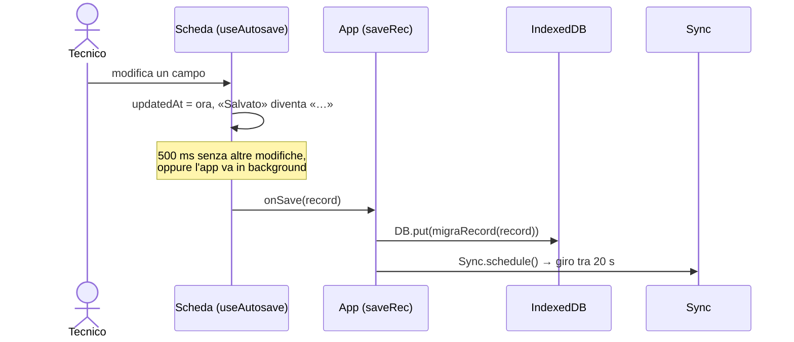
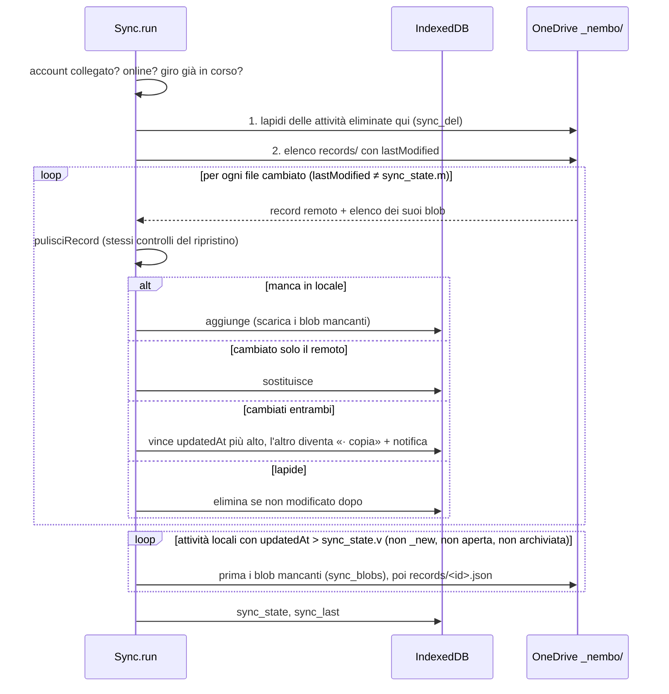
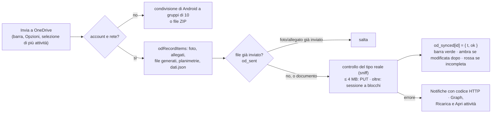
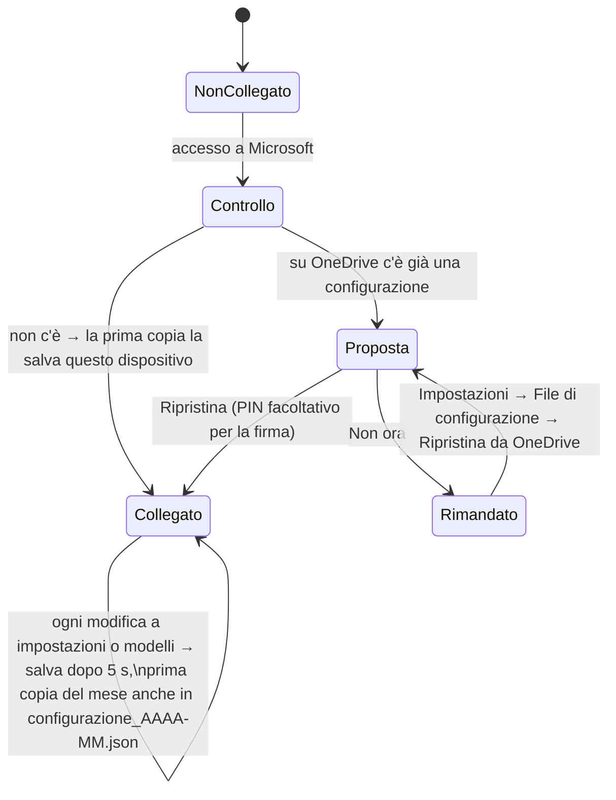
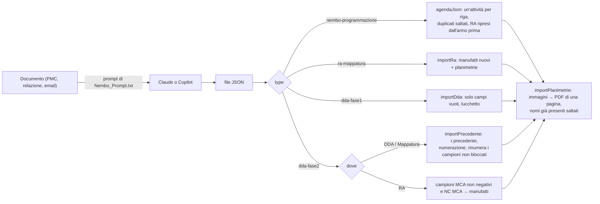
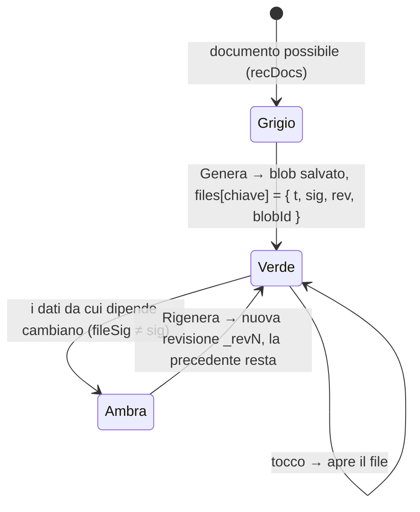
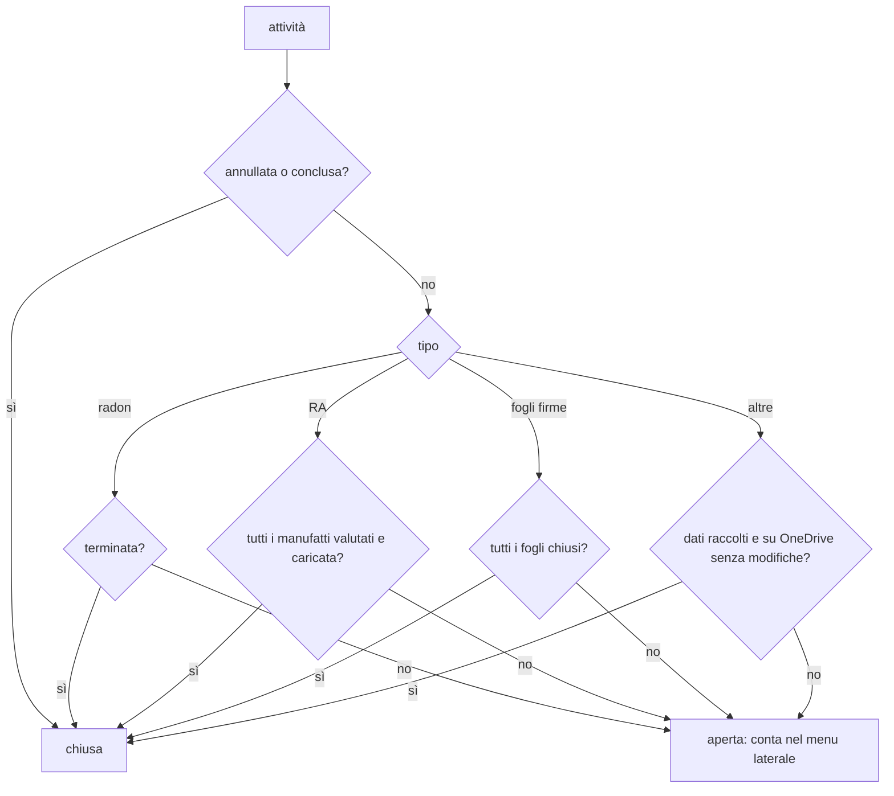
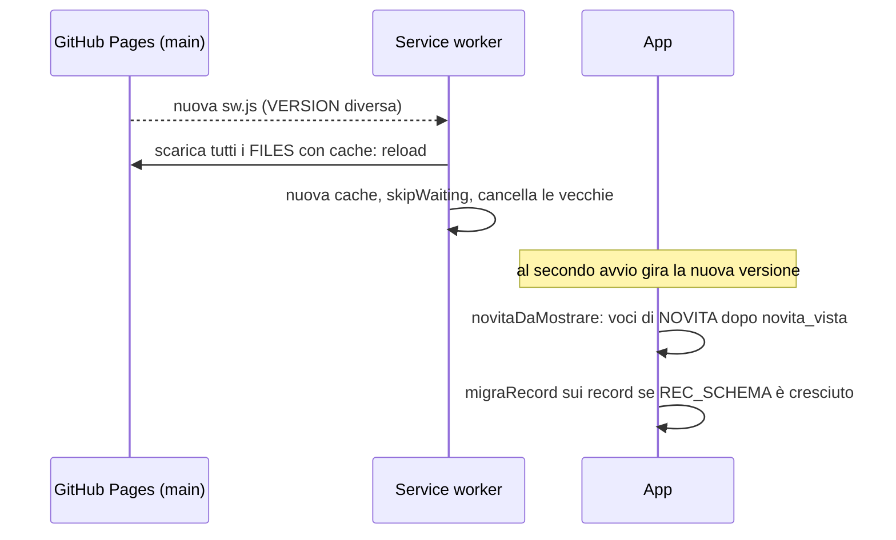

# Schemi di funzionamento

Ogni schema descrive cosa succede davvero nel codice; tra parentesi le funzioni da guardare.

## 1. Salvataggio di un'attività

Non esiste un tasto Salva. Un record nuovo vuoto non viene salvato. Le foto vengono ridotte a 1600 px e salvate come blob (`saveImage`), il record tiene solo gli id.

## 2. Sincronizzazione tra dispositivi

Quando parte: dopo il primo caricamento, al collegamento a OneDrive, al ritorno della rete (1,5 s), al ritorno in primo piano se l'ultimo giro ha più di 2 minuti, 20 s dopo un salvataggio, 3 s dopo un'eliminazione, con «Sincronizza ora» e (v51) toccando l'icona in Oggi.
Icona in Oggi (v51): verde se l'ultimo giro riuscito ha meno di 24 ore, arancione se è più vecchio o offline, rossa se non è riuscito o l'accesso va rinnovato, grigia se OneDrive non è collegato.

## 3. Invio a OneDrive (cartelle leggibili)

Con la selezione (v49) le attività scelte partono in un solo invio, ognuna nella sua cartella; senza OneDrive diventano un unico ZIP (`exportRecords`).

## 4. Backup e ripristino

```mermaid
flowchart TB
  subgraph Backup
    B1["Crea backup completo / Salva su OneDrive"] --> B2["buildZip: cartelle leggibili,<br/>impronta SHA-256 di ogni file, manifest.json"]
    B2 --> B3["firma.json: firma del dispositivo (ECDSA)<br/>+ firma del codice utente"]
    B3 --> B4{"OneDrive collegato e online? (v51)"}
    B4 -- sì --> B5["_nembo/backup/Nembo_backup_….zip<br/>(senza firma del tecnico)"]
    B4 -- no --> B6[Download / Salva con nome]
  end
  subgraph Ripristino
    R1["ZIP scelto o uno degli ultimi 3 su OneDrive"] --> R2{firma}
    R2 -- non corrisponde --> RX[annullato]
    R2 -- assente o dispositivo sconosciuto --> R3[chiede conferma]
    R2 -- valida --> R4
    R3 --> R4["ogni file: impronta e tipo reale;<br/>ogni record: pulisciRecord"]
    R4 --> R5["sostituisce solo i record più vecchi;<br/>scartati e alterati nelle Notifiche"]
    R5 --> R6{impostazioni e modelli?}
    R6 -- conferma --> R7[pulisciImpostazioni, checkTemplate, salva]
  end
```

## 5. Configurazione su OneDrive (v51)

- Un dispositivo salva solo se è «collegato» (`cfg_od.ok`): così uno nuovo non sovrascrive la configurazione buona.
- La firma va su OneDrive solo cifrata: AES-GCM con chiave PBKDF2 (310.000 iterazioni) dal PIN di 6 cifre. Sul dispositivo resta la chiave non esportabile, mai il PIN. Se al ripristino il PIN manca o è sbagliato, la firma remota resta quella e il resto viene ripristinato.
- Il codice utente non va su OneDrive; resta nel file di configurazione esportato.

## 6. Import dai documenti

Numerazione che prosegue (v50): `precBase` prende il numero più alto tra indagine importata e attività in Nembo dello stesso immobile (`precNembo`, `stessoImmobile`); i nuovi campioni partono da lì, salvo `numerazione: "nuova"` o interruttore spento.

## 7. Scheda File

Dopo la generazione della scheda campioni i codici MCA/FAV restano bloccati (`congelati`). I file generati vanno su OneDrive subito o al prossimo invio.

## 8. Attività aperte, concluse e «Da completare»

«Concludi l'attività» (v50) salva `conclusa = { il, motivo, mancanze }`: l'attività esce da «Da completare» e dai numeri del menu anche con foto o manufatti mancanti; nell'RA i manufatti senza stato restano «Non visionato». Si riapre dalle Opzioni.

## 9. Aggiornamento dell'app

## 10. Notifiche

Esiti e errori dei caricamenti, promemoria radon, copie da conflitto, Novità ed errori dell'app (`APP-JS`) vanno in `kv.notifiche` (ultime 200, scritte in coda). Gli errori non letti diventano il pallino rosso sul profilo (v51) e la campanella nelle schermate interne; la pagina Notifiche ha i filtri Tutte · Errori · Esiti, «Ricarica», «Apri attività» e «Copia dettagli».
